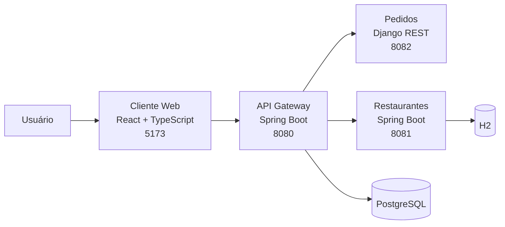

# ComandaFácil

Sistema web para gerenciamento de restaurantes, mesas, cardápio e pedidos.
O projeto implementa um API Gateway, dois microsserviços e um cliente web.

## Requisitos

| Requisito | Implementação |
| --- | --- |
| API Gateway | Spring Boot em `gateway`, porta `8080` |
| HATEOAS | `GET /` e `GET /api` retornam links dos recursos |
| JWT | Cadastro e login no Gateway; rotas de negócio protegidas |
| Documentação | Swagger/OpenAPI em `/api/docs/` |
| APIs internas | Microsserviços de Pedidos e Restaurantes |
| Cliente web | React/TypeScript em `web`, porta `5173` |

## Arquitetura



- **Gateway**: ponto único de entrada, autenticação, roteamento e HATEOAS.
- **Pedidos**: pedidos e itens, usando Django REST Framework e PostgreSQL.
- **Restaurantes**: restaurantes, mesas, categorias e produtos, usando Spring
  Boot, JPA e H2.
- **Cliente web**: interface para dashboard, mesas, cardápio e pedidos.

## Tecnologias

Java 25, Spring Boot, Spring Cloud Gateway, Python, Django REST Framework,
PostgreSQL, H2, React 19, TypeScript, Vite, Material UI, Docker Compose, JWT
HS256 e BCrypt.

## Execução

### Pré-requisitos

Docker, Docker Compose, OpenSSL, Node.js e `pnpm`.

### Configuração

Crie `.env` na raiz do projeto:

```dotenv
JWT_SECRET=defina-um-segredo-com-pelo-menos-32-bytes
DATABASE_USERNAME=postgres
DATABASE_PASSWORD=defina-uma-senha-forte
DATABASE_NAME=comandafacil_db
```

Gere valores aleatórios com `openssl rand -hex 32`. O mesmo segredo deve ser
usado pelo Gateway e pelos microsserviços. Não publique o arquivo `.env`.

### Backend

```bash
docker compose up -d --build
docker compose ps
docker compose logs -f gateway pedidos restaurantes
```

### Cliente web

```bash
cd web
pnpm install
pnpm start
```

Abra <http://localhost:5173>. O Gateway estará em
<http://localhost:8080>. Para encerrar os contêineres:

```bash
docker compose down
```

Para executar o sistema em uma máquina da rede e permitir acesso de outros
computadores, consulte o [guia de execução em rede](./docs/execucao-em-rede.md).

## Autenticação

Cadastro e login não exigem token:

```bash
curl -X POST http://localhost:8080/api/auth/register \
  -H "Content-Type: application/json" \
  -d '{"name":"Maria Silva","email":"maria@example.com","password":"senha1234"}'

curl -X POST http://localhost:8080/api/auth/login \
  -H "Content-Type: application/json" \
  -d '{"email":"maria@example.com","password":"senha1234"}'
```

As respostas contêm `accessToken`, `expiresIn` e `user`. O token é válido por
oito horas. Para acessar uma rota protegida, envie o valor no cabeçalho HTTP
`Authorization`, no formato padrão de autenticação de tokens JWT:

```bash
curl http://localhost:8080/api/auth/me \
  -H "Authorization: TOKEN_JWT"
```

O Gateway valida assinatura, emissor, audiência e expiração. Senhas são
armazenadas com BCrypt.

## HATEOAS

```bash
curl http://localhost:8080/api
```

A resposta contém `_links` para o próprio recurso, autenticação, pedidos,
restaurantes e documentação. Exemplo:

```json
{
  "_links": {
    "self": {"href": "http://localhost:8080/api", "method": "GET"},
    "restaurantes": {"href": "http://localhost:8080/api/restaurantes", "method": "GET"},
    "pedidos": {"href": "http://localhost:8080/api/pedidos", "method": "GET"},
    "documentation": {"href": "http://localhost:8080/api/docs/", "method": "GET"}
  }
}
```

## APIs

### Pedidos

Base: `http://localhost:8080/api/pedidos/`

| Método | Endpoint | Ação |
| --- | --- | --- |
| GET | `/api/pedidos/` | Lista pedidos; aceita filtro por status |
| POST | `/api/pedidos/` | Cria pedido |
| GET | `/api/pedidos/{id}/` | Consulta pedido e itens |
| PUT/PATCH | `/api/pedidos/{id}/` | Atualiza pedido |
| DELETE | `/api/pedidos/{id}/` | Exclui pedido |

### Restaurantes

Base: `http://localhost:8080/api/restaurantes/`

| Recurso | Operações |
| --- | --- |
| Restaurantes | `GET`, `POST`, `GET/{id}`, `PATCH/{id}`, `DELETE/{id}` |
| Categorias | `GET`, `POST`, `GET/{id}`, `PATCH/{id}`, `DELETE/{id}` |
| Produtos | `GET`, `POST`, `GET/{id}`, `PATCH/{id}`, `DELETE/{id}` |
| Mesas | `GET`, `POST`, `GET/{id}`, `PATCH/{id}`, `DELETE/{id}` |

## Swagger e OpenAPI

- Swagger agregado: <http://localhost:8080/api/docs/>
- OpenAPI do Gateway: <http://localhost:8080/v3/api-docs>
- Swagger de Pedidos: <http://localhost:8080/api/pedidos/docs/>
- Schema de Pedidos: <http://localhost:8080/api/pedidos/schema/>
- Swagger de Restaurantes: <http://localhost:8080/api/restaurantes/docs/>
- Schema de Restaurantes: <http://localhost:8080/api/restaurantes/schema/>

No botão **Authorize**, informe o token JWT no formato indicado pela própria
documentação para executar as rotas protegidas.

## Documentação complementar

- [Especificação do trabalho](./docs/projeto-rest.md)
- [API de Pedidos](./docs/pedidos/api.md)
- [Domínio de Pedidos](./docs/pedidos/dominio.md)
- [Modelo relacional de Pedidos](./docs/pedidos/relacional.md)
- [API de Restaurantes](./docs/restaurantes/api.md)
- [Domínio de Restaurantes](./docs/restaurantes/dominio.md)
- [Modelo relacional de Restaurantes](./docs/restaurantes/relacional.md)
