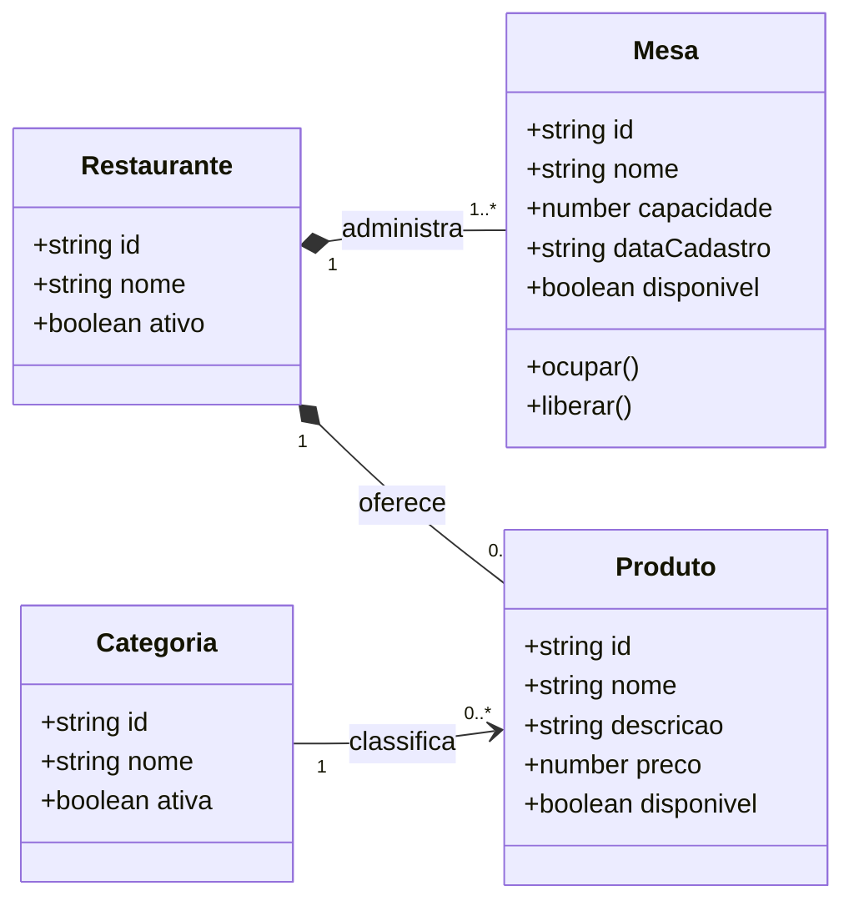

# Diagrama de domínio — Microsserviço de Restaurantes

Este contexto é responsável pelo cadastro e pela disponibilidade dos recursos
do restaurante. Ele é o proprietário das mesas e dos produtos. O pedido
consome esses dados por identificadores e contratos, sem acessar diretamente
as entidades internas deste serviço.

