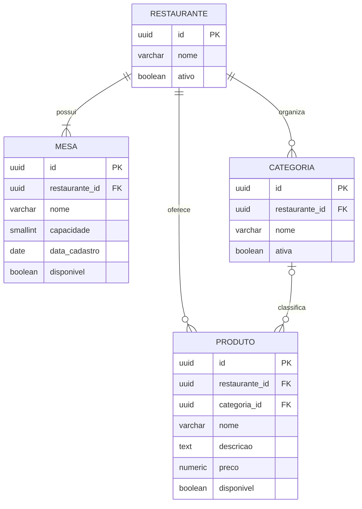

# Diagrama relacional — Microsserviço de Restaurantes

O banco do microsserviço de Restaurantes contém somente dados sob sua
responsabilidade. `PEDIDO` não aparece neste esquema; o microsserviço de
Pedidos mantém apenas o `mesa_id` e consulta a disponibilidade por API quando
necessário.

